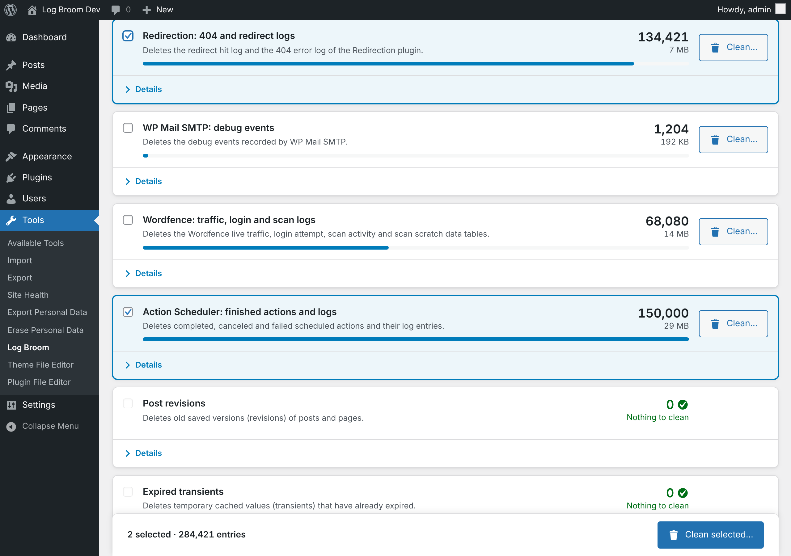

# Log Broom

Log Broom is a lightweight WordPress plugin that safely cleans database log bloat. It covers WooCommerce, Wordfence, Redirection, Rank Math, WP Mail SMTP, Solid Security and WP Activity Log, plus post revisions and expired transients.

## Features

- **Detects what your site has.** A source only appears when its database tables exist, including leftovers from uninstalled plugins.
- **Deletes only log data.** Live data is always kept: pending WooCommerce and Action Scheduler tasks, active security lockouts, your redirects, Wordfence settings, blocked IPs and 2FA, and autosaves.
- **Backup confirmation.** Every clean asks you to confirm you have a database backup, and the server checks that confirmation too.
- **Batched cleaning for huge logs.** Batches size themselves automatically, growing on fast servers and shrinking on slow ones. You can also set a fixed size under Advanced.
- **Detailed progress.** A checklist for each source, speed and time left, and pause/resume.
- **Optional daily or weekly cleaning** through WP-Cron. You choose which sources to include.
- **Database only.** Log Broom never touches files.
- **Lightweight.** It loads only on its own admin page, has no external requests and no tracking, and uses only jQuery from WordPress core.

## Supported sources

| Source | Tables cleaned | Kept |
|---|---|---|
| Action Scheduler (WooCommerce and others) | `actionscheduler_actions` (finished), `actionscheduler_logs` | pending and in-progress tasks |
| WooCommerce database log | `woocommerce_log` | (WooCommerce stores logs as files by default; Log Broom doesn't touch files) |
| Redirection | `redirection_logs`, `redirection_404` | your redirects |
| Rank Math 404 Monitor | `rank_math_404_logs` | redirections, analytics |
| WP Mail SMTP | `wpmailsmtp_debug_events` | mailer settings, email queue |
| Wordfence | `wfHits`, `wfStatus`, `wfLogins`, `wfHoover` | settings, blocked IPs, 2FA |
| Solid Security | `itsec_logs`, `itsec_temp`, expired `itsec_lockouts` | active lockouts, bans |
| WP Activity Log | `wsal_occurrences`, `wsal_metadata` | plugin settings |
| Post revisions | revision rows in `posts` / `postmeta` | autosaves, your posts |
| Expired transients | expired rows in `options` / `sitemeta` | unexpired transients |

On multisite, the network-wide sources (Wordfence, Solid Security, WP Activity Log) are only available to the network super admin on the main site.

## Requirements

- WordPress 6.0 or later
- PHP 7.4 or later

## License

GPLv2 or later. See [LICENSE](LICENSE).

Made by [MyHost](https://myhost.co.il/).
